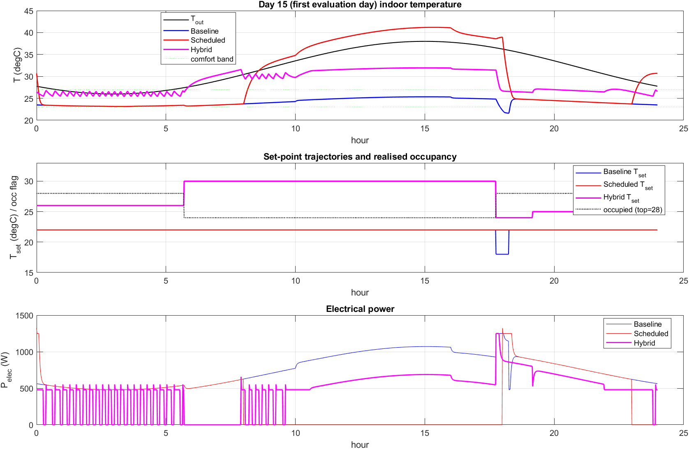
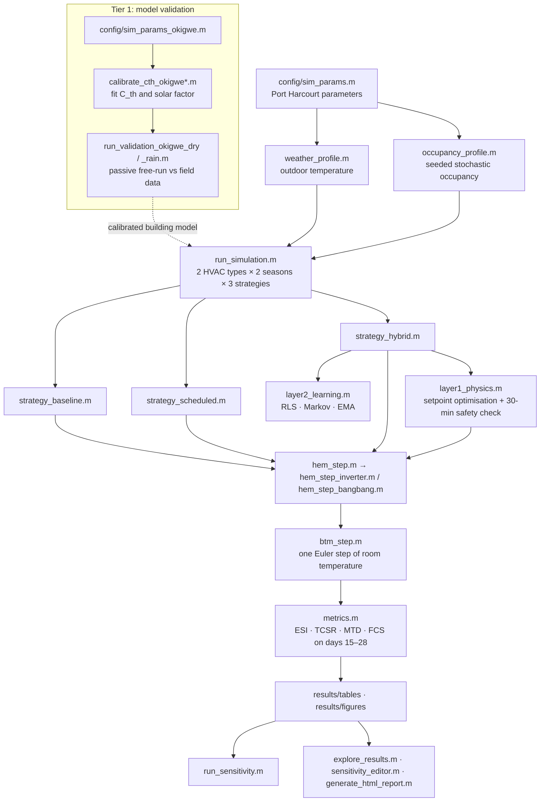
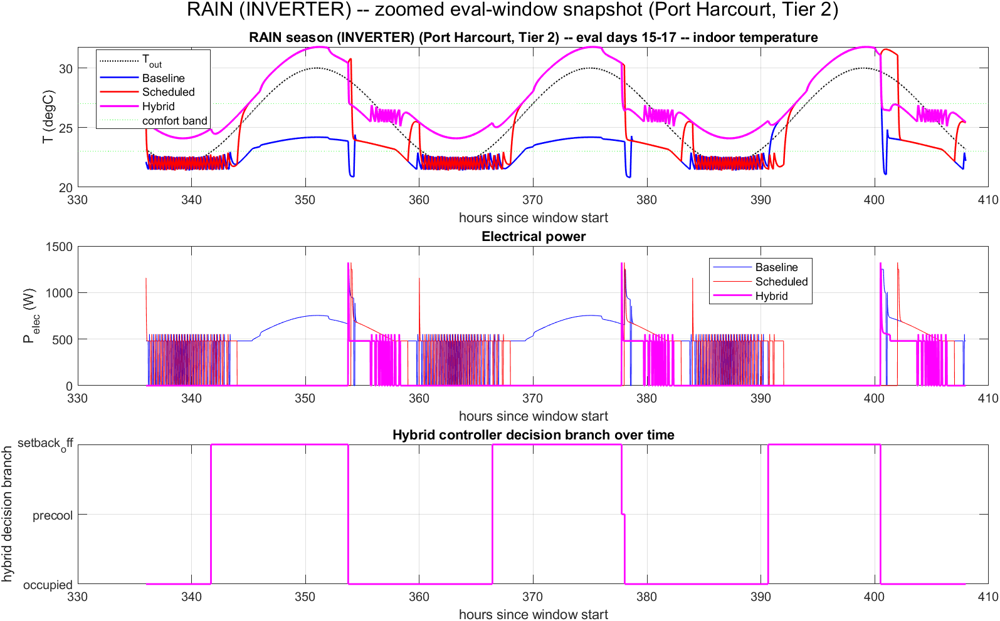
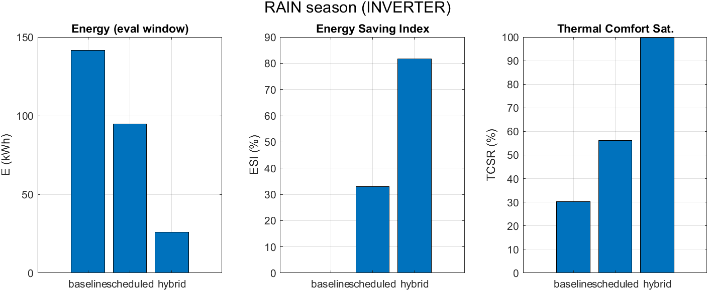
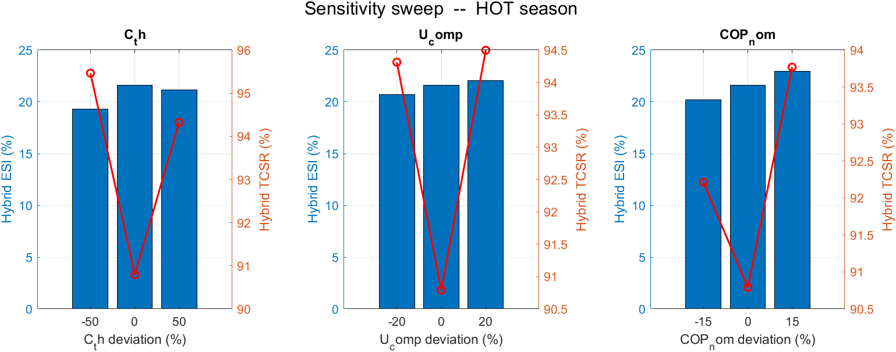
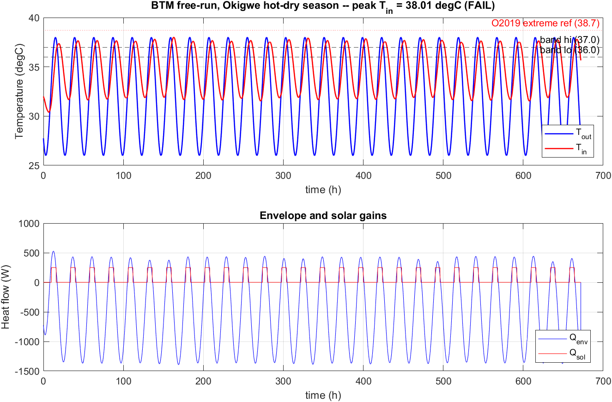

# Non-Intrusive Hybrid Supervisory Control for Split Air Conditioners

**MATLAB simulation of an add-on controller that learns a room's thermal behaviour and occupancy pattern to cut split-AC energy use in tropical buildings, without replacing or opening up the air conditioner.**

Final-year B.Eng. project, Department of Mechanical Engineering, University of Port Harcourt (2026).
Author: Ugonna David Ugochukwu-Okeogu



---

## The problem

Split air conditioners dominate cooling energy use in Nigerian homes and small offices. Typical use wastes a lot of energy: units are set very cold (around 18 °C), left running in empty rooms, and during grid outages they are often powered by diesel or petrol generators. Replacing existing units with smart ones is too expensive for most users. This project asks whether a **low-cost, non-intrusive overlay** could cut that waste while keeping occupants comfortable. The overlay would sense presence and power draw, then send commands to the existing unit over infrared, just as its remote control does.

## Approach

The overlay is designed around an ESP32 microcontroller, an LD2410 mmWave presence radar, an SCT-013 current clamp and an infrared emitter. Before any hardware is built, the control framework is designed and evaluated in a **minute-resolution MATLAB simulation**:

- **Building Thermal Model (BTM).** A single-zone, lumped-capacitance ODE covering envelope conduction, internal gains, roof solar gain and a latent-load penalty in the rainy season. It is integrated with explicit Euler at a 60 s step.
- **HVAC Energy Models (HEM).**
  - *Inverter unit:* continuous capacity modulation (30–100%) and COP degradation at high outdoor temperature.
  - *Fixed-speed ("bang-bang") unit:* on/off hysteresis, a 5-minute minimum compressor run time and a 1.8× start-up inrush.
- **Three control strategies** compared on identical, seeded weather and occupancy:
  1. **Baseline**: manual use. The unit is switched on at 18 °C on arrival and left running after departure with 50% probability.
  2. **Scheduled**: a fixed timer holding 22 °C during pre-set morning, evening and weekend windows.
  3. **Hybrid supervisor** (this work), with two layers:
     - *Layer 2 (learning):* Recursive Least Squares tracks the envelope U-value, a Markov chain learns occupancy probability by day type and hour, and an Exponential Moving Average tracks the occupant's preferred temperature.
     - *Layer 1 (physics-based optimisation):* an event-triggered choice of setpoint from 23–27 °C that minimises energy plus a comfort penalty. Every candidate is checked by a 30-minute forward simulation before use. When the room is empty, the controller sets back to 30 °C, or switches off if the room is already cool, and pre-cools when the Markov model predicts an arrival within 20 minutes.
- **Fair evaluation.** Days 1–14 are the learning period and days 15–28 the evaluation window. The learners are frozen after day 14 and all metrics are computed on days 15–28 only.
- **Metrics.** Energy-Saving Index (ESI), Thermal Comfort Satisfaction Rate (TCSR), Mean Temperature Deviation (MTD) and generator Fuel-Cost Saving (FCS, ₦).

## Processing chain



## Key results (simulated, 14-day evaluation window, Port Harcourt climate)

| AC type | Season | Strategy | Energy (kWh) | ESI (%) | TCSR (%) | MTD (°C) | Fuel saving (₦) |
|---|---|---|---:|---:|---:|---:|---:|
| Inverter | Hot-dry | Baseline | 206.4 | – | 97.0 | 1.72 | – |
| Inverter | Hot-dry | Scheduled | 140.1 | 32.1 | 75.0 | 3.50 | 36,794 |
| Inverter | Hot-dry | **Hybrid** | **161.8** | **21.6** | **90.8** | **0.89** | **24,750** |
| Inverter | Rainy | Baseline | 141.4 | – | 30.2 | 0.70 | – |
| Inverter | Rainy | Scheduled | 94.8 | 33.0 | 56.3 | 1.44 | 25,921 |
| Inverter | Rainy | **Hybrid** | **26.0** | **81.6** | **99.7** | **0.88** | **64,116** |
| Fixed-speed | Hot-dry | **Hybrid** | **168.2** | **24.0** | **90.1** | **1.45** | **29,459** |
| Fixed-speed | Rainy | **Hybrid** | **26.7** | **82.7** | **96.6** | **1.23** | **70,835** |

Full table: [`results/tables/metrics_combined.csv`](results/tables/metrics_combined.csv)

- In the **rainy season**, the hybrid controller cuts energy use by about 82%. The room usually stays cool enough on its own when empty, so the controller leaves the compressor off for most unoccupied time.
- In the **hot-dry season**, savings are smaller (about 22–24%). The controller has to cap the temperature of the empty room so it is still comfortable when the occupant returns. The timer schedule saves more energy here (32%), but comfort falls badly (TCSR 75%, MTD 3.5 °C).
- **Robustness:** across an 18-run sensitivity sweep (thermal capacitance ±50%, envelope U-value ±20%, COP ±15%; inverter unit), hybrid ESI stayed between 19.3–23.0% (hot-dry) and 79.5–82.4% (rainy), and TCSR stayed above 90%.

| Hybrid controller decisions (rainy season, inverter) | Energy and comfort by strategy (rainy season, inverter) |
|---|---|
|  |  |

| Sensitivity sweep (hot-dry season) | Building-model validation (Okigwe, hot-dry) |
|---|---|
|  |  |

**Model validation.** The passive (AC-off) building model was calibrated and checked against published field measurements from dwellings in Okigwe, south-east Nigeria (Ogbonnaya, 2019). Calibration gives an effective thermal capacitance of about 4.05 MJ/K, which matches a heavy sandcrete envelope. The simulated hot-season peak deviates by +1.51 °C, within the ±2.44 °C measurement uncertainty derived in the report.

## Repository layout

```
├── run_simulation.m        main entry point: full Tier-2 study
├── setup_paths.m           adds src/, config/, validation/, tests/, analysis/ to the path
├── config/                 parameter sets (Port Harcourt study, Okigwe validation)
├── src/
│   ├── model/              building thermal model, HVAC models, weather and occupancy generators
│   ├── control/            baseline, scheduled and hybrid strategies; learning and physics layers
│   └── eval/               performance metrics
├── validation/             Tier-1 calibration and validation scripts
├── tests/                  sanity checks run before the full study
├── analysis/               sensitivity sweep, interactive explorers, HTML report generator
└── results/                selected CSV tables and PNG figures from the reported run
```

## How to run

1. Clone the repo and open the repo root in MATLAB, so that `results/` is written relative to the root.
2. Run `setup_paths`. It adds the project folders to the MATLAB path and changes into the repo root.
3. Optional sanity checks: `sanity_hem`, `sanity_hem_bangbang`, `sanity_occupancy`, `sanity_strategies`.
4. Tier-1 validation: `run_validation_okigwe_dry`, `run_validation_okigwe_rain`.
5. Full study: `run_simulation`. This writes CSVs to `results/tables/`, PNG/FIG figures to `results/figures/` and the full results struct to `results/run_simulation_results.mat`.
6. Sensitivity sweep: `run_sensitivity`.
7. Explore the results:
   - `explore_results`: interactive viewer with a time scrubber, plus season and AC-type toggles
   - `sensitivity_editor`: live parameter sliders
   - `generate_html_report`: one self-contained HTML report; also writes the zoomed snapshots to `results/report/zoom_*.png`

All random draws use a fixed seed (`p.seed = 2025`), so re-running reproduces the reported numbers.

## Requirements

- MATLAB **R2024b or later** (desktop), or MATLAB Online
- No add-on toolboxes. Only core MATLAB functions are used, including `uifigure`/`uislider` for the interactive tools and `exportgraphics` for figure export.

## Scope and limitations

- This is a **simulation study**. The ESP32/radar/current-clamp/IR overlay is specified at system level only; this repository has no hardware firmware or field trial.
- The room is modelled as a single zone with one lumped thermal capacitance. Outdoor temperature is a sinusoidal daily profile fitted to climate normals, not measured weather.
- Commands to the AC are sent over infrared with no feedback confirming the unit received them (open-loop).

## Full report

The full project report, with derivations, the literature review and the complete discussion, is held by the **University of Port Harcourt** and is not part of this repository. Equation numbers cited in code comments (e.g. "Eq. 3.18") refer to that report.

## Reference

Field data used for validation: Ogbonnaya, I.O. (2019). *An evaluation of ground pipe ventilation and overnight radiant cooling to displace air conditioning in Warm Humid South Eastern Nigeria.* PhD thesis. University of Strathclyde, Glasgow.

## License

This project is released under the [PolyForm Noncommercial License 1.0.0](LICENSE).

- **Allowed:** use, study, modify and share the code for research, education, personal projects and other noncommercial purposes, provided the license text and the copyright notice stay with it.
- **Not allowed:** using it, or anything built from it, to make money or in a commercial product or service. For commercial use, contact the author.

Required Notice: Copyright (c) 2026 Ugonna David Ugochukwu-Okeogu
